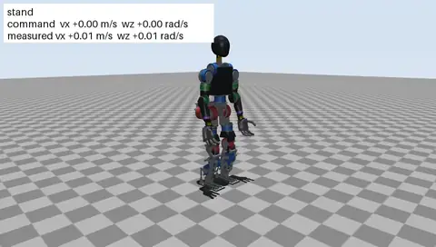
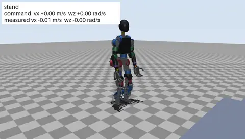

# Marvin Bot

An open humanoid robot, about 1.29 m tall and 39 kg, with 25 powered joints. It is built from off-the-shelf quasi-direct-drive actuators, a CNC-machined aluminium frame and printed structural shells, and uses an NVIDIA Jetson AGX Orin for onboard compute.

**Status:** phase 1, robot in simulation. Nothing has been built yet. The full robot is modelled in code-CAD, and walking and stair-climbing policies trained in Isaac Lab pass a cross-check in MuJoCo; a motion-tracking pipeline (human motion to robot skills) is being brought up. See [docs/roadmap.md](docs/roadmap.md).


## In simulation

| Walking, turning and stopping (flat v7) | 15 cm stairs up and down (rough v9) |
|---|---|
|  |  |

Policies are trained in Isaac Lab on Newton and replayed in MuJoCo with sensor noise (`sim/mujoco/check_policy.py --render`); results for every run are in [sim/isaaclab/README.md](sim/isaaclab/README.md).

## Goals

- Walk, turn and stop on flat ground and rough terrain; climb standard household stairs (17–18 cm steps).
- Carry and manipulate light objects (1–2 kg) with two 5-DOF arms.
- Look good with or without its outer shell: the shells are part of the structure.
- Stay buildable by one person with a desktop CNC mill and a desktop 3D printer, for roughly $10–12k in parts.
- Be fully open: CAD, electronics, firmware, simulation and training code.

The full list is in [docs/requirements.md](docs/requirements.md).

## Design at a glance

| | |
|---|---|
| Height, mass | ~1.29 m, ≤35 kg target, ≤40 kg limit (current estimate in [description/mass_budget.yaml](description/mass_budget.yaml)) |
| Joints | 6 per leg, 5 per arm, waist yaw, 2 neck, plus a 1-DOF gripper per arm |
| Actuators | Robstride RS04 (hip pitch and roll, knees), RS03 (hip yaw, ankles, waist, shoulders), RS06 (shoulder yaw, elbows), RS00 (wrists); serial-bus servos for neck and grippers |
| Compute | Jetson AGX Orin 64 GB; desktop GPU for training and, at first, for the vision-language-action model |
| Sensing | Pelvis IMU, head-mounted active-stereo depth camera, joint encoders |
| Power | 48 V nominal (13S Li-ion, ~630 Wh), quick-release pack with a keep-alive supply for the computer |
| Comms | 6 CAN buses for the actuators, 1 auxiliary CAN bus for the battery |
| Software | Isaac Lab for training, MuJoCo as a cross-check, ProtoMotions for motion tracking, ROS 2 Jazzy on the robot, GR00T N1.7 for manipulation |

The joint list, ranges and actuators are defined in [description/robot.yaml](description/robot.yaml), the single source of truth for everything else.

## Repository layout

```
docs/          plan, requirements, roadmap, safety, decisions, design notes, media (renders, clips)
description/   robot.yaml (joints, sizes, CAN buses), actuators.yaml, mass_budget.yaml,
               skeleton.yaml (frames, mass placement), urdf/ (generated)
cad/           code-CAD part generators (legs, pelvis, torso, arms, head, clip-on covers),
               the mass and size build, and the strength check
electrical/    wiring harness (harness.yaml, generated by tools/build_harness.py)
bom/           bill of materials (bom.csv); generated build lists of made parts and actuator bolts
tools/         checks and generators (description check, BOM summary, URDF, harness, sketch)
sim/mujoco/    MuJoCo checks (standing, step-up, symmetry, policy cross-check)
sim/isaaclab/  Isaac Lab robot config, walking tasks, robot check, policy export
sim/motion/    motion pipeline: human motion retargeted to Marvin Bot, tracking policies (ProtoMotions)
robot/         onboard software (Robstride CAN driver so far)
bench/         actuator bench tests (phase 2)
tests/         unit tests
```

Folders for CAD, electronics, the onboard software, simulation and bench tests are added as each phase reaches them; [docs/plan.md](docs/plan.md) describes the full layout.

## Checks

```bash
pip install -e ".[dev]"
ruff check . && ruff format --check .
python tools/check_description.py   # joints, actuators, CAN load, mass budget, BOM counts
python tools/bom_summary.py         # BOM totals by phase and group
python tools/build_urdf.py --check  # URDF matches the description files
python tools/build_harness.py       # wiring harness routes, gauges and fuses (electrical/)

pip install -e ".[cad]"
python -m cad.build                 # part meshes, masses and inertias; part sizes vs mill and printer
python -m cad.strength              # hand-calc strength check of the frame and printed parts
python -m cad.covers --check        # shells and parts swept through the joint ranges
python -m cad.export                # STL per part, DXF per flat part (outputs/), build BOM (bom/)

pip install -e ".[sim]"
python sim/mujoco/check_standing.py # stands in MuJoCo; joint torques against ratings
```

CI runs the same checks on every push.

## Licences

- Software and documentation: [Apache-2.0](LICENSE)
- Hardware designs (CAD, drawings, electronics): [CERN-OHL-S-2.0](LICENSES/CERN-OHL-S-2.0.txt)

Vendor CAD models are not redistributed here; see [CONTRIBUTING.md](CONTRIBUTING.md). Credits for the projects and products this design learns from are in [ACKNOWLEDGMENTS.md](ACKNOWLEDGMENTS.md).

## Safety

A 39 kg robot on a 48 V battery can injure people. Read [docs/safety.md](docs/safety.md) before powering any actuator.
