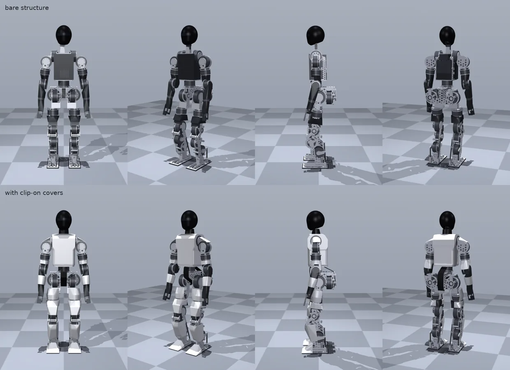
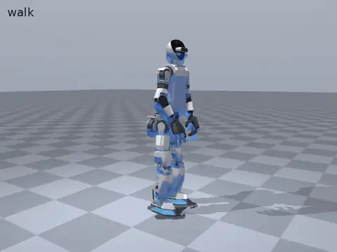
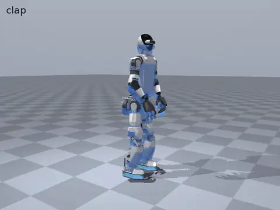
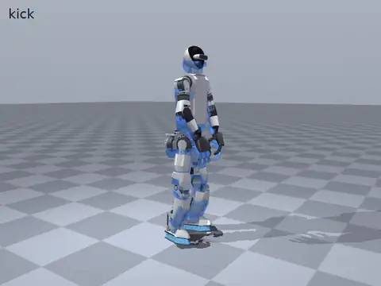

# Marvin Bot

[](https://github.com/kranthie/marvin-bot/actions/workflows/ci.yml)   

An open humanoid robot, about 1.44 m tall and 41 kg, with 27 powered joints and two 8-servo four-finger hands. It is built from off-the-shelf quasi-direct-drive actuators, a CNC-machined aluminium frame and printed structural shells, and uses an NVIDIA Jetson AGX Orin for onboard compute.

**Status:** phase 1, robot in simulation. Nothing has been built yet. The full robot is modelled in code-CAD, and walking and stair-climbing policies trained in Isaac Lab pass a cross-check in MuJoCo (the stair policy still falls in 2 of 15 runs on 15–20 cm stairs over five noise seeds); a motion-tracking policy follows 25 generated human motions (walking, turning, jogging, kicking, squatting, gestures; see the [skills page](docs/skills.md)), not yet replayed in MuJoCo. See [docs/roadmap.md](docs/roadmap.md).

**Start here:** this README, then [docs/plan.md](docs/plan.md) (phases), [docs/roadmap.md](docs/roadmap.md) (where things stand), [docs/decisions.md](docs/decisions.md) (why things are the way they are) and the [glossary](docs/README.md#glossary). To try it: `pip install -e ".[dev]" && python tools/check_description.py`.

> [!WARNING]
> **Work in progress, not yet built or tested on hardware.** The designs, policies and scripts
> here are shared for reference, research and learning. They have only run in simulation; the
> motor driver and bench scripts are untested. A robot of this size (about 40 kg, 48 V,
> joints up to 120 N·m) can cause serious injury, fire or damage if built or run wrongly. Build
> or power any part of it only if you are experienced with high-power robotics and batteries,
> follow [docs/safety.md](docs/safety.md), and at your own risk: everything is provided as is,
> without warranty, under the licences below. Report safety issues privately
> ([SECURITY.md](SECURITY.md)).



<sub>MuJoCo render of the generated model (`tools/render_robot.py`). Hands: AmazingHand meshes by Pollen Robotics, CC-BY-4.0.</sub>

## In simulation

| Walking | Clapping | Kicking |
|---|---|---|
|  |  |  |

One motion-tracking policy plays 25 skills on the current 1.44 m model: the solid robot is the trained policy, the translucent blue robot the reference motion it follows (human motion generated with Kimodo and retargeted to Marvin Bot). It is trained on Newton in ProtoMotions and every clip stays upright; all 25, with their tracking errors, are on the [skills page](docs/skills.md), and the pipeline is in [sim/motion/README.md](sim/motion/README.md). Not yet replayed in MuJoCo.

Separate walking and stair-climbing policies are trained in Isaac Lab and replayed in MuJoCo with sensor noise; their clips and results are in [sim/isaaclab/README.md](sim/isaaclab/README.md). They were trained on the earlier 1.29 m body and still pass their checks on the current model, but walk with the knees bent about 40° (15° intended) until they are retrained for it.

## Goals

- Walk, turn and stop on flat ground and rough terrain; climb standard household stairs (17–18 cm steps); recover from pushes and get up after a fall.
- Carry and manipulate light objects with two 6-DOF arms and four-finger hands (1–2 kg is the goal; the v1 hands manage about 0.5 kg), learned from teleoperated demonstrations with a vision-language-action model (GR00T N1.7).
- Learn skills beyond walking by tracking human motion (gestures, whole-body teleoperation), trained in simulation before the robot is built ([roadmap](docs/roadmap.md#skills-beyond-walking-simulation-before-and-during-the-build)).
- Look finished without its clip-on covers: the visible parts are the structure, and the covers are an optional add-on.
- Stay buildable by one person with a desktop CNC mill and a desktop 3D printer, for about $17.5k in parts at October 2026 prices (`bom/bom.xlsx`, totalled by `tools/bom_summary.py`). That includes the Jetson AGX Orin 64 GB developer kit ($3,499) and the two hand kits, which this build already owns, so it still has about $13.8k to buy. Not included: the desktop CNC mill, the 3D printer, shipping, import duties, and the desktop GPU for training (optional, see `bom/README.md`).
- Be fully open: CAD, electronics, firmware, simulation and training code.

The full list is in [docs/requirements.md](docs/requirements.md).

## Built on

Marvin Bot is a new design, but it stands on open work by others:

- **Layout and sizing:** the open humanoids [Asimov 1](https://github.com/menloresearch/asimov-1) and [Roboto Origin](https://github.com/Roboparty/roboto_origin) (ideas and reference figures only), with lessons on low-cost building from [Berkeley Humanoid Lite](https://github.com/HybridRobotics/Berkeley-Humanoid-Lite) and [ToddlerBot](https://github.com/hshi74/toddlerbot).
- **Hands:** the [AmazingHand](https://github.com/pollen-robotics/AmazingHand) by Pollen Robotics (CC-BY-4.0), bought as kits; its meshes are in `description/third_party/`.
- **Training and simulation:** NVIDIA [Isaac Lab](https://github.com/isaac-sim/IsaacLab) and Newton, [ProtoMotions](https://github.com/NVlabs/ProtoMotions) with [PyRoki](https://github.com/chungmin99/pyroki) for motion tracking on human motion generated with [Kimodo](https://github.com/nv-tlabs/kimodo), [MuJoCo](https://github.com/google-deepmind/mujoco) for the cross-checks, and [GR00T](https://github.com/NVIDIA/Isaac-GR00T) planned for manipulation.
- **Actuators:** [RobStride](https://github.com/RobStride/Product_Information)'s published manuals and specifications.
- **Built with [Claude](https://claude.ai) and [Claude Code](https://claude.com/claude-code)** (Anthropic): the design, CAD, simulation, training code and documentation were developed with them; commits they contributed to are marked `Co-Authored-By: Claude`.

Every source, with its licence and what was used from it, is in [ACKNOWLEDGMENTS.md](ACKNOWLEDGMENTS.md).

## Design at a glance

| | |
|---|---|
| Height, mass | ~1.44 m; 40.4 kg bare and 41.3 kg with the body shells (estimate, `tools/check_description.py`); 35 kg target bare, 42 kg limit with the shells |
| Joints | 6 per leg, 6 per arm (wrist yaw and pitch), waist yaw, 2 neck, plus an 8-DOF four-finger hand per arm |
| Actuators | Robstride RS04 (hip pitch and roll, knees), RS03 (hip yaw, ankles, waist, shoulder pitch and roll), RS06 (shoulder yaw, elbows), RS00 (wrists); serial-bus servos for the neck and wrist pitch; eight small servos in each hand |
| Compute | Jetson AGX Orin 64 GB; desktop GPU for training and, at first, for the vision-language-action model |
| Sensing | Pelvis IMU, head-mounted active-stereo depth camera, joint encoders |
| Power | 48 V nominal (13S Li-ion, ~630 Wh), quick-release pack with a keep-alive supply for the computer |
| Comms | 6 CAN buses for the actuators, 1 auxiliary CAN bus for the battery; Feetech serial buses for the neck and wrist servos and for each hand |
| Software | Isaac Lab for training, MuJoCo as a cross-check, ProtoMotions for motion tracking, ROS 2 Jazzy on the robot, GR00T N1.7 for manipulation |

The joint list, ranges and actuators are defined in [description/robot.yaml](description/robot.yaml), the single source of truth for everything else.

## Repository layout

```
docs/          plan, requirements, roadmap, safety, decisions, design notes, media (renders, clips)
description/   robot.yaml (joints, sizes, CAN buses), actuators.yaml, mass_budget.yaml,
               skeleton.yaml (frames, mass placement), urdf/ (generated),
               third_party/ (AmazingHand meshes, CC-BY-4.0)
cad/           code-CAD part generators (legs, pelvis, torso, arms and hand mounts, head, covers),
               the mass and size build, and the strength check
electrical/    wiring harness (harness.yaml, generated by tools/build_harness.py)
bom/           bill of materials workbook (bom.xlsx): bought parts by group, where to buy them,
               totals, and the CAD's lists of made parts and actuator bolts
tools/         checks and generators (description check, BOM summary and workbook, URDF,
               harness, hand meshes, README render, concept sketch, vendor CAD fetch, check_all.sh)
sim/mujoco/    MuJoCo checks (standing, step-up, symmetry, policy cross-check)
sim/isaaclab/  Isaac Lab robot config, walking tasks, robot check, policy export
sim/motion/    motion pipeline: human motion retargeted to Marvin Bot, tracking policies (ProtoMotions)
robot/         onboard software (RobStride CAN driver so far; untested on hardware)
bench/         actuator bench tests (phase 2)
tests/         unit tests
```

More folders (for example build guides) are added as later phases reach them.

## Checks

```bash
python3.12 -m venv .venv && . .venv/bin/activate   # CI uses Python 3.12; 3.10 or later works
pip install -e ".[dev,cad,sim]"
tools/check_all.sh                  # every check CI runs, in CI's order
```

Or one at a time:

```bash
python tools/check_description.py   # joints, actuators, CAN load, mass budget, BOM counts
python tools/bom_summary.py         # BOM totals by phase and group
python tools/bom_book.py --check    # BOM workbook valid and tidy (python tools/bom_book.py tidies it)
python tools/build_urdf.py --check  # URDF matches the description files
python tools/build_harness.py --check  # wiring harness routes, gauges and fuses (electrical/)
python -m cad.build                 # part meshes (needed by every MuJoCo check), masses, sizes
python -m cad.strength              # hand-calc strength check of the frame and printed parts
python -m cad.covers --check        # shells and parts swept through the joint ranges
python -m cad.export                # STL per part, DXF per flat part (outputs/), CAD sheets of bom/bom.xlsx
python sim/mujoco/check_standing.py # stands in MuJoCo; joint torques against ratings
pytest -q tests
MUJOCO_GL=egl python tools/render_robot.py   # the robot picture above; MUJOCO_GL=egl without a display
```

CI (`.github/workflows/ci.yml`) runs `tools/check_all.sh` on every push and pull request.

## Build status

Nothing here is ready to build from yet. What exists, and what a builder would still need:

| Area | Status |
|---|---|
| Frame | code-CAD, first passes; STL and DXF per part; no drawings, tolerances, fits or fastener lengths |
| Printed parts | STL; no print settings |
| Electronics | power topology, wiring harness estimate and bay layout; no schematics or boards; several parts not chosen |
| Battery | concept only: do not build from it |
| Assembly | assembly order and wiring notes ([docs/design/assembly_wiring.md](docs/design/assembly_wiring.md)); no assembly drawings or torque values |
| Software on the robot | RobStride CAN driver and bench scripts, untested |

## Licences

Copyright 2026 The Marvin Bot contributors.

| Path | Licence |
|---|---|
| `cad/` (part generators), `description/` (robot description, URDFs, meshes), `electrical/`, `bom/`, `docs/design/*.svg` | [CERN-OHL-S-2.0](LICENSES/CERN-OHL-S-2.0.txt) (hardware) |
| Everything else: `tools/`, `sim/`, `robot/`, `bench/`, `tests/`, the documentation and media | [Apache-2.0](LICENSE) |
| `description/third_party/amazing_hand/` | CC-BY-4.0 and Apache-2.0, © Pollen Robotics ([details](description/third_party/amazing_hand/README.md)) |
| Portions of `sim/isaaclab/` marked in their headers | also BSD-3-Clause, © The Isaac Lab Project Developers ([text](LICENSES/BSD-3-Clause-IsaacLab.txt)) |

[NOTICE](NOTICE) lists the third-party material and the hardware licence's source location. Vendor CAD models and motion data are not redistributed here; see [CONTRIBUTING.md](CONTRIBUTING.md). Credits for the projects and products this design learns from are in [ACKNOWLEDGMENTS.md](ACKNOWLEDGMENTS.md). Everything is provided as is, without warranty, as these licences state.

## Safety

A 40 kg robot on a 48 V battery can injure people. Read [docs/safety.md](docs/safety.md) before powering any actuator. Report safety or security issues privately, as described in [SECURITY.md](SECURITY.md).

## Contributing

See [CONTRIBUTING.md](CONTRIBUTING.md). Everyone taking part is expected to follow the [code of conduct](CODE_OF_CONDUCT.md).
