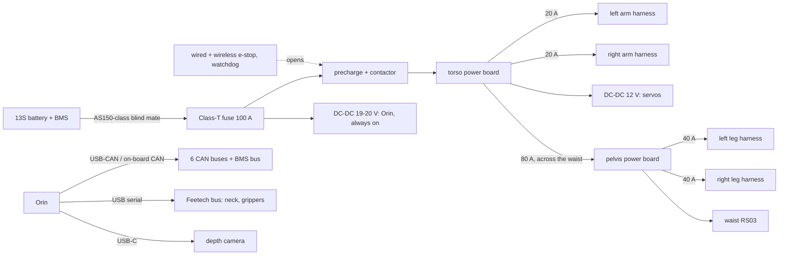

# Assembly, wiring and covers

How the robot comes apart, how the wiring runs, and what the optional covers add. Status as of 2026-10-26: first-pass CAD of every structural part (`cad/`), a generated harness (`tools/build_harness.py` → `electrical/harness.yaml`), and the covers as an add-on (`cad/covers.py`). Fasteners, clips and connector footprints are still to come.

## Modules

The robot is built from seven modules that are assembled and tested on their own, then joined at a small number of bolted interfaces and connectors:

| Module | Contents | Joins at | Connectors at the joint |
|---|---|---|---|
| Torso core | torso frame, chest shell, Orin, electronics bay, battery cradle, shoulder pitch and neck yaw motors | waist RS03 output flange (bolted) | trunk harness: power plus 5 CAN pairs |
| Pelvis | box frame, waist RS03, hip pitch RS04s, pelvis power board | waist flange; leg flanges | leg root connectors |
| Leg (×2) | hip roll to foot: 5 actuators, linkage, foot | hip pitch RS04 output flange | 1 power, 1 signal |
| Arm (×2) | shoulder bracket to gripper: 4 actuators, gripper servo | shoulder pitch RS03 output flange | 1 power, 1 signal |
| Head | neck bracket, pitch servo, frame, shell, visor, camera | neck yaw servo horn | servo bus, camera USB-C |
| Battery | 13S pack with BMS | slides into the cradle from the back | blind-mate power and BMS connector |
| Covers | clip-on panels (optional) | clips on the parts below | none |

Each limb's first actuator stays on the parent module (hip pitch on the pelvis, shoulder pitch on the torso), so a limb comes off by removing the bolts on one output flange and unplugging two connectors. That meets R63: any actuator in a limb can be changed with only that limb off the robot.

## Assembly order

1. Pelvis: frame plates, hip pitch RS04s, waist RS03, pelvis power board; bench-test the three motors on a short CAN stub.
2. Legs: build each leg from the hip roll bracket down; set the ankle linkage (rod lengths from `tools/ankle_linkage.py`) with the foot flat at zero; test each leg on the single-leg jig before joining.
3. Torso core: frame, shoulder pitch RS03s, neck yaw servo, electronics bay, Orin, battery cradle and the e-stop chain; power up without limbs.
4. Join the torso core to the pelvis at the waist flange; plug in the trunk harness through its service loop.
5. Arms and head onto their flanges and connectors.
6. Calibrate joint zeros with the robot hung from the gantry (docs/safety.md), then add the covers if wanted.

## Power and signal topology

The computer's supply is taken before the contactor, so an e-stop cuts every actuator but keeps the Orin, logs and state alive (docs/safety.md). The torso power board feeds the arms; the legs' power crosses the waist once, as a trunk, to a second board in the pelvis. The waist motor sits on the right-arm CAN bus (robot.yaml) but takes its power from the pelvis board.

## Harness

`tools/build_harness.py` generates `electrical/harness.yaml` from the description files, so the harness follows any change to motor positions, joint ranges or buses. CI checks it is up to date. Current figures:

| Harness | Branch current | Fuse | Length | Carries |
|---|---|---|---|---|
| Main (battery to torso board) | 78.5 A | 100 A | — | 6 AWG |
| Trunk (torso to pelvis, across the waist) | 51.3 A | 80 A | 0.57 m | 8 AWG, 4 leg CAN pairs, waist CAN |
| Leg (each) | 24.3 A | 40 A | 1.62 m | 12 AWG at the root down to 16 AWG; hip and shank CAN |
| Arm (each) | 13.6 A | 20 A | 1.83 m | 16 AWG; arm CAN; 12 V and serial for the gripper |
| Head | — | — | 0.30 m | 12 V and serial for the neck servos; camera USB-C |

The currents are continuous estimates: rated torque at half the no-load speed, 80% efficiency, 48 V, with half the branch's motors at rated output at once. Peak currents are several times higher for short periods; the fuse and gauge choices are first-pass, and the real bus currents come from the phase 2 bench test (open item 3 in [roadmap.md](../roadmap.md)).

Rules the harness follows:

- **One harness per limb**: power is daisy-chained motor to motor in kinematic order, with the limb's CAN pair(s) twisted alongside. Each motor's own power and CAN connectors plug into the chain, so a motor swap needs no crimping.
- **Service loops at every joint**: a loop of length range × 35 mm around each joint the harness crosses (0.04–0.15 m per joint). The loop runs beside the motor housing, on the side away from the output flange, inside the clearance the packaging check keeps. The waist and shoulder pitch, the joints with the largest ranges, get the longest loops.
- **No wire carries load**: the harness is clipped to the structure on both sides of each loop, so motion only flexes the loop.
- **CAN**: twisted pair, 120 Ω termination at the hub end and on the last motor of each bus, shield or drain grounded at the hub only. Each leg carries two buses (hip and shank), so its signal connector has 6 pins.
- **Limb-root connectors**: a keyed 2-pin power connector rated above the branch fuse (XT60 class for legs and arms) and a latching signal connector (CAN pairs, ground, a spare), both mounted on a bulkhead on the parent module next to the limb's first flange.
- **Paths**: the leg harness drops from the pelvis board between the hip pitch motor and the frame, behind the hip roll motor, down the back of the thigh shell and the shin web to the ankle motors. The arm harness leaves the torso beside the shoulder pitch motor, runs inside the upper-arm and forearm shells (they leave a cable channel; the upper-arm shell has an exit at the elbow for the loop), and ends at the gripper servo.

## Covers (add-on)

The bare robot is meant to look finished: graphite printed shells (thigh, upper arm, forearm, chest, head), bead-blasted aluminium plates and the actuators' own housings. The covers are an optional layer of light 2 mm printed panels over the thigh, shin, hip, shoulder, pelvis front, chest, back and collar:

- generated from the parts they cover (an offset skin at a 4 mm gap), so they refit automatically when the structure changes;
- trimmed short of every joint, so they never touch the next link;
- clipped on (clip and boss details come with the fastener pass), so they come off without tools for service;
- carrying no load; they add some fall protection (R53).

The covers weigh 0.56 kg in all. The default model (`description/urdf/marvin_bot.urdf`, 39.20 kg) is the bare robot, and the policies are trained on it. `marvin_bot_covers.urdf` (39.76 kg) adds the covers' mass and visuals; a robot that runs with covers should be trained on it.

## Still to do

- Fastener holes, bearing seats, clips and connector footprints in the CAD.
- Harness clip points and loop guides in the CAD; check the loops against the packaging envelopes through the full joint ranges.
- Covers in the packaging check: they are trimmed by hand at the joints so far, and checked only visually in a deep squat.
- The battery cradle and blind-mate connector; the electronics bay layout.
- Measured bus currents (phase 2) to confirm the gauges and fuses.
