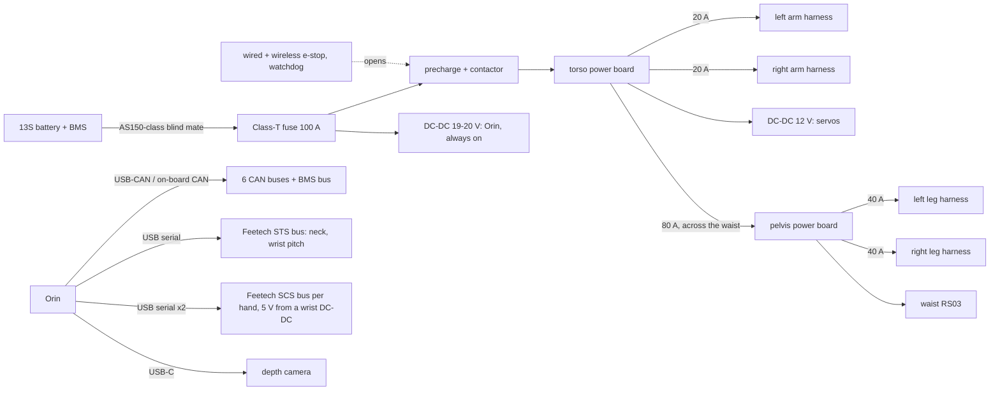

# Assembly, wiring and covers

How the robot comes apart, how the wiring runs, and what the optional covers add. Status as of 2026-10-31: first-pass CAD of every structural part (`cad/`), the electronics bay, battery cradle and limb-root bulkheads at their parts' outlines (`cad/electrical.py`), a generated harness (`tools/build_harness.py` → `electrical/harness.yaml`), and the covers as an add-on (`cad/covers.py`). Fastener holes and the harness clip points are in the parts; shell clips and the bought parts' datasheet outlines are still to come.

## Modules

The robot is built from seven modules that are assembled and tested on their own, then joined at a small number of bolted interfaces and connectors:

| Module | Contents | Joins at | Connectors at the joint |
|---|---|---|---|
| Torso core | torso frame, Orin, electronics bay, battery cradle, shoulder pitch and neck yaw motors | the waist hub, which turns in the pelvis's crossed-roller bearing (bolted) | trunk harness: power plus 5 CAN pairs |
| Pelvis | back plate, top plate and gussets, waist RS03 on its bearing ring, hip roll RS04s with their bearing carriers, pelvis power board, 12 V servo DC-DC, IMU | waist hub; leg hubs | leg bulkheads |
| Leg (×2) | roll yoke to foot: 5 actuators (hip pitch, yaw, knee, two ankle), linkage, foot | the yoke's front plate on the hip roll hub, which turns in the carrier's bearing | 1 power, 1 signal, at the leg bulkhead |
| Arm (×2) | shoulder bracket to hand: 4 actuators (shoulder roll, yaw, elbow, wrist yaw), wrist pitch servo, hand | shoulder pitch RS03 output flange | 1 power, 1 signal, at the arm bulkhead |
| Head | neck bracket, pitch servo, frame, shell, visor, camera | neck yaw servo horn | servo bus, camera USB-C |
| Battery | 13S pack with BMS | slides into the cradle from the back | blind-mate power and BMS connector |
| Body shells | clip-on shells (optional) | clips on the parts below | none |

Each limb's first actuator stays on the parent module (hip roll on the pelvis, shoulder pitch on the torso), so a limb comes off by removing the bolts on one hub and unplugging two connectors (the hub and its bearing stay on the parent). That meets R63: any actuator in a limb can be changed with only that limb off the robot.

## Making the parts

`python -m cad.export` writes an STL of every made part (mm, sitting on z = 0) and a DXF outline of every flat part (a plate of one thickness: the laser or water-jet service's input, and the mill's 2D toolpaths) to `outputs/parts/`, and two build lists that CI keeps current, as sheets of `bom/bom.xlsx`: Made parts (each made part once, mirror pairs as quantity 2, with process, material, stock thickness, mass and size; bought parts and shells listed for completeness) and Actuator bolts (the actuator bolts from each motor's stator and output hole circles). Each sheet has a status column for tracking the build, which the export keeps. Right-side parts are the left ones mirrored and are exported as their own files.

## Assembly order

1. Pelvis: back plate with the hip roll RS04s, top plate and gussets, waist RS03, pelvis power board; bench-test the three motors on a short CAN stub.
2. Legs: build each leg from the hip roll bracket down; set the ankle linkage (rod lengths from `tools/ankle_linkage.py`) with the foot flat at zero; test each leg on the single-leg jig before joining.
3. Torso core: frame, shoulder pitch RS03s, neck yaw servo, electronics bay, Orin, battery cradle and the e-stop chain; power up without limbs.
4. Join the torso core to the pelvis at the waist flange; plug in the trunk harness through its service loop.
5. Arms and head onto their flanges and connectors.
6. Calibrate joint zeros with the robot hung from the gantry (docs/safety.md), then add the covers if wanted.

## Electronics layout

| Where | What, in power-flow order |
|---|---|
| Torso, back, high | 13S pack on a shelf under the shoulder motors, behind the electronics bay, between two printed side guides; a latch plate behind it. It slides out backwards with the back shell off; its blind-mate connector (AS150 class) is at its front-top corner and seats in a socket at the front of its bay. |
| Torso, middle | the computer on edge: fan forward (vents in the torso covers), I/O ports to the sides, buttons up, bolted by its feet to a plate behind it. |
| Torso, bay above the computer | main contactor and precharge, torso power board (bus bars, arm fuses), e-stop receiver and watchdog relay; the computer's DC-DC (fed ahead of the contactor); three isolated USB-CAN adapters beside the computer's USB ports. |
| Torso, low at the back | keep-alive pack under the battery (keeps the computer up during a pack swap). |
| Shoulder plates | the arm bulkheads, behind the shoulder pitch motors. |
| Pelvis channel, under the waist motor | 12 V DC-DC for the servos (a compact 10 A brick, at most 60 × 34 × 25 mm), the IMU near the hip axes. |
| Pelvis, between the hip roll motors | pelvis power board (leg fuses) with the leg bulkheads under it. |

The outlines are typical sizes for each class of part; each is replaced with the chosen part's datasheet outline when it is bought, and the sweep and rest-pose audit rerun.

## Power and signal topology

The computer's supply is taken before the contactor, so an e-stop cuts every actuator but keeps the Orin, logs and state alive (docs/safety.md). The torso power board feeds the arms; the legs' power crosses the waist once, as a trunk, to a second board in the pelvis. The waist motor sits on the right-arm CAN bus (robot.yaml) but takes its power from the pelvis board.

## Harness

`tools/build_harness.py` generates `electrical/harness.yaml` from the description files, so the harness follows any change to motor positions, joint ranges or buses. CI checks it is up to date. Current figures:

| Harness | Branch current | Fuse | Length | Carries |
|---|---|---|---|---|
| Main (battery to torso board) | 78.5 A | 100 A | — | 6 AWG |
| Trunk (torso to pelvis, across the waist) | 51.3 A | 80 A | 0.58 m | 8 AWG, 4 leg CAN pairs, waist CAN |
| Leg (each) | 24.3 A | 40 A | 2.07 m | 12 AWG at the root down to 16 AWG; hip and shank CAN |
| Arm (each) | 13.6 A | 20 A | 1.98 m | 16 AWG; arm CAN; 12 V and serial for the wrist pitch servo and the hand |
| Head | — | — | 0.49 m | 12 V and serial for the neck servos; camera USB-C |

The currents are continuous estimates: rated torque at half the no-load speed, 80% efficiency, 48 V, with half the branch's motors at rated output at once. Peak currents are several times higher for short periods; the fuse and gauge choices are first-pass, and the real bus currents come from the phase 2 bench test (open item 3 in [roadmap.md](../roadmap.md)).

Rules the harness follows:

- **One harness per limb**: power is daisy-chained motor to motor in kinematic order, with the limb's CAN pair(s) twisted alongside. Each motor's own power and CAN connectors plug into the chain, so a motor swap needs no crimping.
- **Service loops at every joint**: a loop of length range × 35 mm around each joint the harness crosses (0.04–0.15 m per joint). The loop runs beside the motor housing, on the side away from the output flange, inside the clearance the packaging check keeps. The waist and shoulder pitch, the joints with the largest ranges, get the longest loops.
- **No wire carries load**: the harness is clipped to a plate on both sides of each loop, so motion only flexes the loop, with spiral wrap over the loop. `harness.yaml` names the two clip parts for every loop (`CLIPS` in `tools/build_harness.py`, checked against `description/cad_model.yaml`). Three kinds:
  - a **push-in cable-tie mount** (a ribbed "fir-tree" stem, bought) in a 6.5 mm hole on a solid 14 mm pad in plates up to 6 mm thick: the hip roll web (two), the hip pitch box's back wall, the thigh floor and plate, the shin's inner plate, the pelvis top plate, the torso base, the shoulder plates, the upper arm strap (two), the forearm frame (two), the wrist cradle's back plate and the neck bracket. `cad/b3d.py`'s `clip_spot` places each hole near its joint, outside the motor and its rings and clear of every other hole, and the plate's pockets keep away from its pad, so later re-pocketing cannot move or cut it;
  - a **printed TPU edge clip** (`cad/clips.py`) that slides over the edge of a plate too thick for a push-in mount and grips it, with a ring outside the edge for the cable tie: the pelvis back plate (one per hip), the hip pitch box's outer wall, the shoulder roll's front plate and the neck bridge. TPU, not PA-CF, because PA-CF is too stiff to snap;
  - a **P-clip under an existing screw** where a plate has no room for either: the shoulder flange, under one of the shoulder pitch output's screws.
- **CAN**: twisted pair, 120 Ω termination at the hub end and on the last motor of each bus, shield or drain grounded at the hub only. Each leg carries two buses (hip and shank), so its signal connector has 6 pins.
- **Limb-root connectors**: a keyed 2-pin power connector rated above the branch fuse (XT60 class for legs and arms) and a latching signal connector (CAN pairs, ground, a spare), both mounted on a bulkhead on the parent module next to the limb's first flange (`elec_bulkhead_*` in `cad/electrical.py`).
- **Paths** (after the front-ring redesign, 2026-10-30). Each RobStride's cable leaves its driver cap at its rear end, through the connectors on the cap's side, so run lengths are measured from the caps.
  - Leg: from the bulkhead in front of the back plate to the hip roll RS04's cap, through its pillar ring's windows behind the hip; forward along the roll motor past its bearing carrier (the roll loop) to the hip pitch RS04's cap, through the windows of its pillar ring on the yoke's web; down the outside of the hip pitch box (tied to its pocketed outer wall) to the hip yaw loop under the box's floor. The hip yaw RS03 now rides on the thigh, its cap down on the thigh floor inside the four cage strips: the harness reaches its connectors between the strips, then runs down the back of the thigh plate, round the knee (tied to the thigh plate and the shin's inner plate) and between the shin's side plates to the two ankle motors, whose caps face each other on the shin's centre line.
  - Waist: the waist RS03's cap sits down on the pelvis top plate inside its cage; the pelvis power board beside it on the same plate feeds it between the strips. The trunk's loop runs round the waist ring between the pelvis top plate and the torso base, tied to both.
  - Arm: from the bulkhead behind the shoulder pitch motor to its cap (inboard, through the shoulder plate), out between the shoulder cage's strips and round the outside of the torso's shoulder ring (the pitch loop, tied to the shoulder plate and the shoulder flange) to the shoulder roll RS03's cap behind it; over the shoulder roll top plate (the roll loop) to the shoulder yaw RS06's cap, which stands up into the top plate's cable hole; round the yaw ring and its two rear strips (the yaw loop) and down the upper arm's strap to the elbow RS06's cap on the arm's inner side; round the back of the elbow, between the strap and the forearm frame (the elbow loop), down the frame to the wrist RS00's rear face, which takes its cable through the wrist bracket's hole; then round the wrist yaw (tied to the bracket and the cradle's back plate) to the wrist pitch servo, beside which a 12 V to 5 V converter feeds the hand's servos (their serial bus is separate: they use Feetech's SCS protocol, the other servos its STS protocol).
  - Where a cap's cable passes through a plate (thigh floors, pelvis top plate, shoulder roll top plates, wrist brackets) the hole takes a rubber grommet (`cable-grommets` in the BOM).

## Body shells (add-on)

The bare robot is an open aluminium frame: bead-blasted 7075 and 6061 plates, the actuators' own housings and a glossy helmet head (its printed chest, thigh and arm shells were removed in 2026-10-30's redesign, as the covers below do their job). The body shells are an optional layer that gives it a finished body: a helmet head with a full-face glossy visor over a slim dark neck, a faceted light torso that widens from the waist to the shoulders, a dark hip girdle, long light leg shells, arm sleeves and toe caps, with the joints left visible between them.

| Shell | Pieces | Notes |
|---|---|---|
| Torso | 8 (front and back, left and right, chest and waist) | faceted: squashed octagons at nine heights round the torso frame, every other one turned 22.5°, hulled into flat panels that meet in diamond facets; broad at the shoulders and slimmer at the waist; the shoulders slope up into a collar round the neck; flat side walls with round openings for the shoulder motors, chamfered at the shoulders, and front corners that bevel deeper towards the shoulders (the shoulder roll bracket swings past them); the back comes off for the battery |
| Neck sleeve | 1, dark, flexible print | flares from the helmet down into the collar; turns with neck yaw inside the torso's neck opening; the head pitches over it |
| Hip girdle | 1, dark | round the pelvis frame and waist motor; reaches over the hip motors in front, stays clear of the hip roll motors that swing round the hip behind |
| Thigh, shin | 1 each per leg | thigh all round except a strip at the back of the inner side (harness), and over the front of the knee motor; shin front and sides, open at the back where the cranks and rods move |
| Shoulder | 1 per side | over the top of the shoulder roll motor only, above the swing of the roll bracket (the hip roll motors behind the hips are left bare) |
| Upper arm, forearm, toe | 1 each per side | sleeves between the joints (the upper arm's runs down the back of the elbow motor), with a grille of slots over the front of each motor housing they cover, as the motors' ratings assume their housings shed heat; a cap over the front of the foot |

How they are made and checked:

- Each shell is a 1.0 mm printed skin at a 4 mm gap from the parts it covers (an offset of their hull, rounded; the torso's is the faceted hull above), so the shells refit automatically when the structure changes. Each has room cut for the harness loops at its joints: a band round the joint's axis over the arc between the loop's two clip points plus 20° of swing, on the rear arc where the two are near equal, as at the knee (`loop_rooms`).
- Generated this way, the frame sets each shell's shape. They are to be redrawn in build123d as designed panels: lofted through cross-sections, an even wall, filleted, split along chosen seams, with clips, and these hulls as the keep-out they must clear (`docs/decisions.md`, 2026-10-31).
- `python -m cad.covers --check` (run in CI) moves every joint to both ends and to half of each end of its range, plus combined poses (deep squat, knee up, arm up, hand to chest, looking down while turned), and fails if any shell touches a part or shell of another link. Shells on one limb are not checked against the other limbs; limb-to-limb contact is the policy's job.
- They clip on (clip and boss details come with the fastener pass), so they come off without tools, and they carry no load; they add some fall protection (R53).

The shells weigh 0.82 kg in all. The default model (`description/urdf/marvin_bot.urdf`, 41.17 kg with the hands) is the bare robot, and the policies are trained on it. `marvin_bot_covers.urdf` (41.99 kg) adds the shells' mass and visuals, inside the 42 kg limit, which applies to the robot with them; a robot that runs with them should be trained on it.

## Still to do

- Connector footprints on the bulkheads, and the RobStride caps' connector positions from a real motor (the paths above assume connectors on the cap's side, between the cage strips).
- Loop envelopes in the packaging check: the shells leave each loop room, but the sweeps check the parts, not the loops themselves.
- Torso shell seams: clip and alignment details at the eight pieces' joins.
- Datasheet outlines for the bought electronics once chosen (the layout uses typical sizes).
- Measured bus currents (phase 2) to confirm the gauges and fuses.
