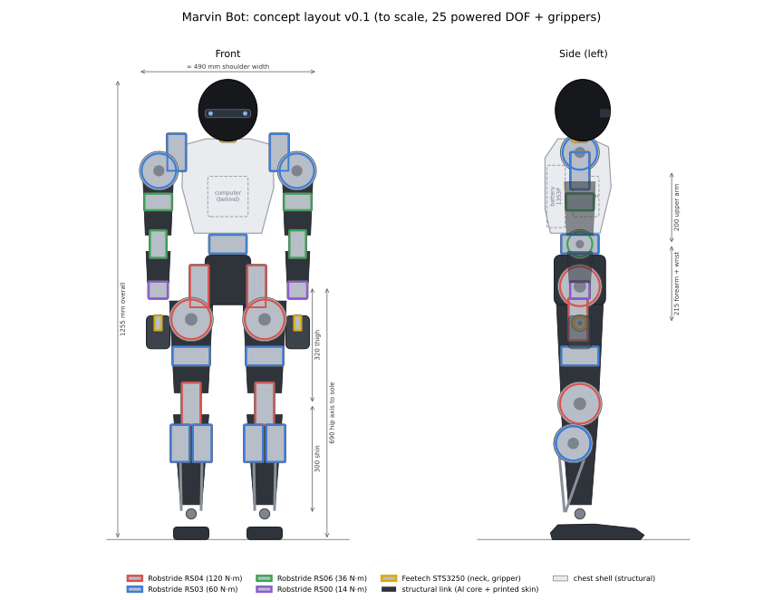

# Concept v0.2

> **Historical:** the v0.2 concept of 2026-10-25, kept as it was. The current design is in the
> README, `description/robot.yaml` and [decisions.md](../decisions.md); the figures, the drawing
> (25 DOF with grippers) and the open questions below are not updated.

The drawing is to scale and shows every powered joint, coloured by actuator model. It is drawn by `tools/sketch_concept.py`, which takes the leg and overall heights and the ankle motor from `description/robot.yaml`. The changes from v0.1 and their reasons are in [decisions.md](../decisions.md).

## Proportions

| | |
|---|---|
| Height | 1.288 m (head CAD, 2026-10-26; 1.215 m in the concept) |
| Hip axis to sole | 0.65 m (53% of height; sized for 17–18 cm stairs) |
| Thigh, shin | 0.30 m, 0.29 m |
| Ankle axis height | 0.06 m |
| Shoulder width | ~0.49 m |
| Upper arm, forearm to wrist pitch, hand | 0.20 m, 0.188 m, 0.181 m |
| Head | ~0.16 m wide, ~0.17 m tall |

## Design language

The goal is a robot that looks finished without a separate cover, because the visible parts are the structure.

- **Limbs:** graphite structural links that taper from joint to joint, with brushed-aluminium actuator caps showing at every joint. The caps are the actuators' own housings or thin machined covers that also act as heat spreaders.
- **Torso:** a light-coloured structural chest piece over an aluminium spine, holding the computer, with the battery behind and below it in a quick-release cradle.
- **Head:** a smooth, glossy dark egg shape with no face. The depth camera sits behind an open slot, not behind glass, because a cover window reflects the camera's IR pattern.
- **Colour:** two-tone, light structural pieces against dark links. The exact scheme is open.
- **Optional covers:** soft covers or padding can be added later at impact points without changing the structure.

## Structure

- **Load path:** machined 6061 cores through each leg and the pelvis. Printed carbon-fibre-nylon shells bolt through to metal inserts and add stiffness, never carry the primary load alone.
- **Part size:** parts are sized for a desktop CNC mill with about 200 × 150 mm usable area. Long thigh and shin cores are split into pinned segments or ordered from an online machining service.
- **Bearings:** far-side bearings at hip roll, hip yaw and knee; a crossed-roller bearing at the waist.
- **Ankles:** two RS03 motors side by side in the calf, 125 mm below the knee, turn 65 mm cranks on their outer faces; ~166 mm push rods with spherical rod ends drive the foot 55 mm behind and ±55 mm beside the ankle axis (`tools/ankle_linkage.py`).
- **Feet:** flat aluminium plates with replaceable rubber or TPU soles; no toe joint in v1.
- **Cables:** each limb's CAN and power run through the joints with service loops; connectors at each limb root so a limb can be removed as a unit.

Stair climbing (status, open issues and options) has its own note: [stairs.md](stairs.md).

## Open design questions for phase 1

- Knee motor at the joint (v1) or near the hip with a linkage: decided by simulated leg inertia and torque.
- Leg length: compare 0.62, 0.65 and 0.69 m hip-to-sole on stairs.
- Exact ankle linkage geometry, push-rod loads and rod-end size.
- Colour scheme and finish of the printed shells.
