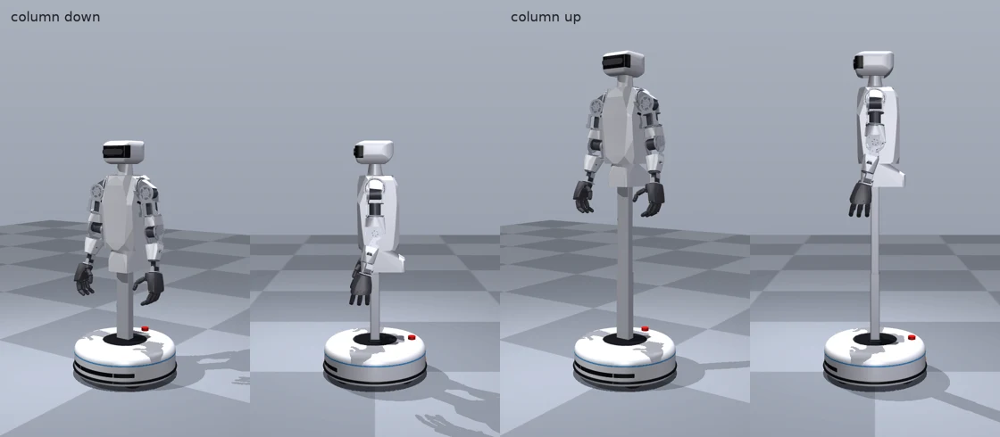
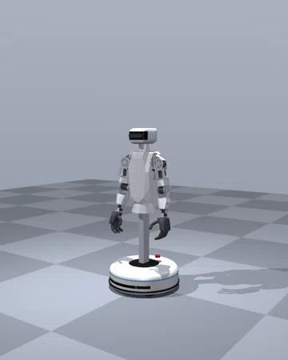
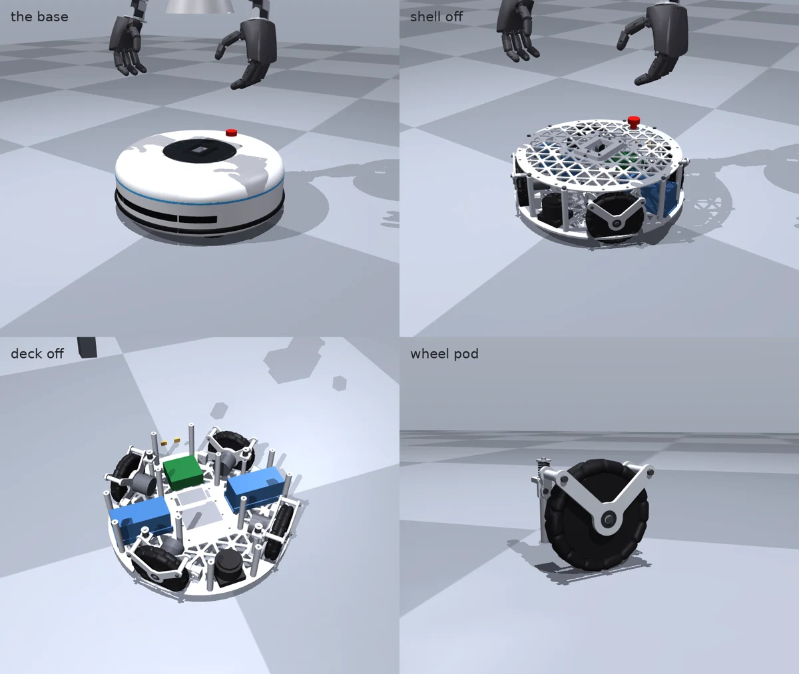

# Lite: the upper body on a wheeled base

Lite is the second Marvin Bot variant. It is Max's upper body from the waist motor up, unchanged:
the waist, torso, arms, hands, neck and head. That upper body sits on a bought standing-desk
lifting column on a round omnidirectional base. Lite has no legs, so it can be built and used for
manipulation long before the walking robot. The choices behind it are in
[decisions.md](../decisions.md) (2026-11-07).

Status: design pass 1 in code-CAD and simulation. None of it is built or tested.

## Layout

| | |
|---|---|
| Height to the top of the head | 1.25–1.70 m (column down to up) |
| Shoulder height | 1.01–1.46 m |
| Base | 0.55 m across, shell 22–185 mm above the floor |
| Wheels | four 152 mm double omni wheels in an X at 45°, 135°, 225° and 315°, each driven directly by an RS00 |
| Column | LINAK DL6, 560 mm retracted, used over 450 mm of its 650 mm stroke, 38 mm/s |
| Mass | 39.06 kg bare, 39.70 kg with the shells (the base 21.9 kg of it, including the column's outer stage) |
| Battery | Max's 13S3P pack, split into two bricks in series at the base's sides |
| Motors | 20: Max's 15 upper-body joints (3 RS03, 6 RS10P, 2 RS00, 4 STS3250) and 4 RS00 wheels, plus the column |

The column stands at the base's centre and the robot faces forward. Turning the torso 180° by
default to reach further would cut the tipping margin to about 29 mm.

## Description and model

Lite is a variant in the same description files as Max. `robot.yaml`'s `variants.lite` keeps
every joint from the waist up, drops the battery from the torso, and adds the column joint, four
wheel joints and their motors. `skeleton.yaml`'s `variants.lite` adds the links:

- `lite_base`: the root, on the floor at the base's centre;
- `column_link`: on the column's top plate;
- one link per wheel.

The URDF builder writes `description/urdf/marvin_bot_lite.urdf` and a version with the shells.
A change to the torso, arms or head reaches both robots. The omni wheels' rollers are not in the
URDF: the MuJoCo check adds them.

## Base (`cad/lite_base.py`)

- **Frame:**
  - A 6 mm 6061 floor plate, too large for the mill, cut by an online service.
  - A 4 mm deck plate, with eight aluminium standoffs between the two plates.
  - The column's foot bolts to the floor plate through a 10 mm foot plate. A split collar on the
    deck holds the column 130 mm higher, so its bending reaches the base as a couple between the
    two plates.
- **Wheel pods:**
  - Each wheel turns between two plates. The RS00 drives it through a hub on the inner plate,
    and a 6901 bearing on a stub axle carries it in the outer plate. The motor's bearing carries
    the torque and little of the weight, the arm's yoke idea.
  - Each pod is a trailing arm on a pivot pin in a clevis block. A spring on a guide post presses
    it down, with about ±8 mm of travel at the wheel, so all four wheels stay loaded. A urethane
    bump stop limits upward travel and a collar limits downward travel.
- **Inside:**
  - The battery bricks sit at the sides, the electronics behind the column and a 2-D lidar in
    front.
  - The e-stop is on the deck, and the charge contacts are low at the back.
- **Shell:**
  - Eight printed PETG segments, each small enough for the 250 mm printer. Each snaps onto the
    floor plate's edge with two cantilever hooks, released from below with a flat screwdriver.
    Each also pins into two rubber grommets in the deck. Neighbouring segments overlap on a lap
    strip.
  - A TPU bumper sits in a groove low on the skirt, with an LED light strip behind a diffuser.
    Three polycarbonate strips close the lidar's openings, and a two-piece dark cover goes round
    the column.
- **Fasteners:** `python -m cad.lite_base --bom` lists them, and `--check` finds no overlapping
  parts.

## Column head (`cad/lite_column.py`)

A 6 mm 7075 plate bolts to the column's top plate and carries the waist RS03 exactly as Max's
pelvis does. The two share one function (`cad/torso.py` `waist_mount`): four cage strips up to a
front ring on the motor's ears, which seats the crossed-roller bearing under the torso's hub. A
printed cone covers the plates and the motor up to the torso.

**Assumptions to confirm before machining:**

- the DL6's foot bracket and top-plate hole patterns;
- the omni wheel's bolt pattern and bore.

## Stability

`sim/mujoco/check_lite.py` puts Lite on its four wheels, with free-turning rollers on each, the
motors' torque limits and a velocity servo per wheel. It runs in CI. Its results (40.2 kg with
the rollers):

| Case | Column | Tipping margin | Braking limit | Sideways push that tips it, at the shoulders |
|---|---|---|---|---|
| Arms down | down / up | 163 mm | 2.5 / 1.7 m/s² | 64 / 45 N |
| Arms forward, 2 kg in each hand | down / up | 88 mm | 1.1 / 0.8 m/s² | 71 / 49 N |

**Braking limit.** The braking limit is what the base controller may use. It is 0.6 of the
deceleration that would tip Lite statically, ramped in over 0.3 s. At 0.8 the rear wheels
unloaded with the column up and the arms forward, because the upper body sways forward on its
joints' servos as the base slows.

**Rules for the base controller.** With the column up, about 45 N at the shoulders tips Lite
sideways. The base controller therefore:

- lowers the column before driving or when people are close;
- limits deceleration by column height and arm pose (`brake_limit()`);
- ramps every change of acceleration.

**Thresholds.** Lite crosses a 10 mm bar sideways, which is an omni wheel's worst direction.

## Strength (`cad/fea.py --variant lite`)

The stress check meshes each group of parts as one bonded solid, holds it where it is supported
and loads it at its interfaces. Results so far:

- **Wheel pod**, held at its pivot and spring tab: a bump at 3 × a wheel's share, a sideways
  knock and the RS00's peak torque at the floor. Lowest SF 6.3 (the spring tab), plates 10 or
  more.
- **Column head**, held on the column: the hand catch and the waist's 60 N·m peak. Lowest SF 17.
- **Base frame** (floor and deck plates, standoffs, foot, collar, clevis blocks, post bases):
  held at the pods, loaded at the column. Cases: a 2 g kerb drop of everything on the column, and
  1.5 × the largest moment the floor can put on Lite before it tips, fore-aft and sideways.
  - At a 6 mm mesh, everything but the floor plate checks at SF 13 or more: deck plate 22,
    column foot 27, collar 54, standoffs 13, clevis blocks and post bases 13.5.
  - The floor plate did not mesh into one solid with the rest at 6 mm. A 4 mm mesh of the whole
    frame outgrew 200 GB, so the floor plate still needs a check of its own, finer or alone.

**The column.** The column is bought, so it is checked against its rating. The worst static
moment at its foot is 52 N·m with the arms forward and 2 kg in each hand, against the DL6's
150 N·m dynamic rating (SF 2.9).

## Skills

Lite's skills reuse the motion pipeline's upper bodies (generated with Kimodo from standing
prompts, retargeted to Marvin Bot). The base path and column height of each clip are written as
keyframes, not taken from the hips: retargeting a walking person would rock the base with the
hips' sway and drive the slow column up and down. Two prompts were added for Lite: holding a box
and handing something over. A third, beckoning, was dropped because the hand rose once in two
wordings. `sim/motion/lite_clips.py` plays each clip on the wheeled MuJoCo model with the joints'
position servos. There is no learned policy, since Lite does not balance. The clips and their
scores are on the [skills page](../skills.md#lite).

## Training

The Isaac Lab package has Lite's articulation (`MARVIN_LITE_CFG`, the base fixed) and a reach
task, `MarvinLite-Reach`. In it, the left hand reaches targets using the column, the waist and
the arm, with a penalty for moving the centre of mass off the column's axis. Both are written and
untested: they still need Lite's USD conversion and a first training run
(`sim/isaaclab/README.md`).

## Wiring and power

The battery bricks sit in series in the base, so the pack is Max's 13S. They feed the same
contactor, BMS and converters, which move down into the base. The wheels share one CAN bus
through a USB adapter. The arms keep their buses on the computer's two on-board CAN ports. The
column's driver, an H-bridge and a microcontroller, sits on USB. The e-stop cuts the wheels' and
arms' motor power and the column's driver.

The harness runs up beside the column to the torso in a coiled cable or drag chain over the
450 mm stroke. It is not yet in `electrical/harness.yaml`.

## Open items

- **Column:** bench-test driving the DL6's motor and Hall sensor directly. The TiMOTION TL18 is
  the fallback.
- **Dimensions:** confirm the column's and wheels' hole patterns.
- **Springs:** size the pod springs.
- **Isaac Lab:** convert Lite's USD and train the reach task.
- **Wiring:** Lite's harness in `electrical/harness.yaml` and the column's drag chain.
- **Lidar:** choose and price it. It is an estimate in the BOM, and the shell's window posts
  block about 7° at each seam.
