# Skills in simulation

Every skill the motion tracker has learned, on the current 1.44 m model. The solid robot is the
trained policy; the translucent blue robot is the reference motion it follows (a human motion
generated with Kimodo and retargeted to Marvin Bot). One policy plays all 25 clips: it was trained
for 4,800 epochs on Newton with 16,384 robots at once (about 7.5 hours on one GPU) and every clip
stays upright. Under each clip: the joints' RMS error against the reference, and the hands' mean
distance from where the reference puts them (both measured relative to the pelvis).

The clips are rendered with `sim/motion/render_tracking.py`; how they are made, trained and scored
is in [sim/motion/README.md](../sim/motion/README.md). This is simulation only: the policy has not
been replayed in MuJoCo or run on hardware, and the weakest skill, the two-hand wave, still lags
its reference by about 35°.

## Walking and turning

| Walk | Walk slow | Walk back |
|---|---|---|
|  | 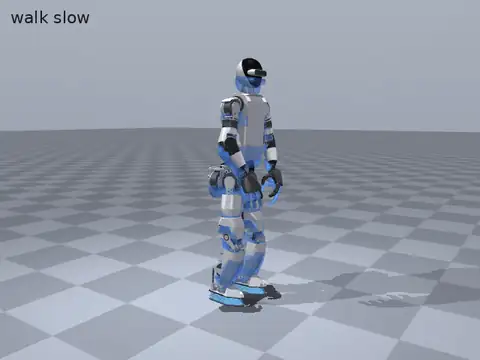 | 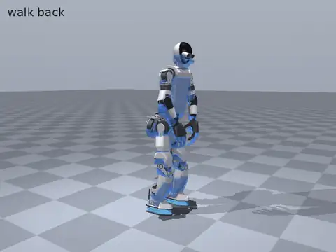 |
| joints 8.5°, hands 6.0 cm | joints 8.1°, hands 6.6 cm | joints 7.9°, hands 7.0 cm |

| Jog | March | Start stop |
|---|---|---|
| 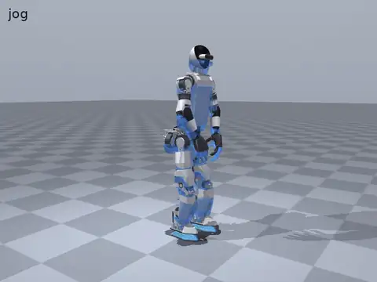 | 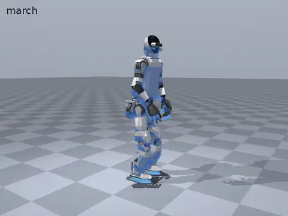 | 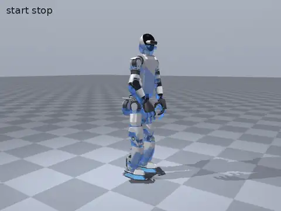 |
| joints 8.8°, hands 5.8 cm | joints 9.2°, hands 4.4 cm | joints 8.8°, hands 5.6 cm |

| Carry walk | Side left | Side right |
|---|---|---|
| 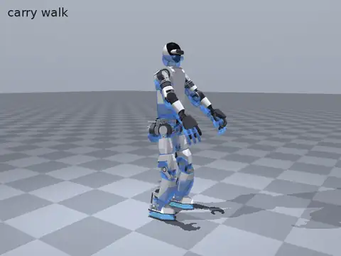 | 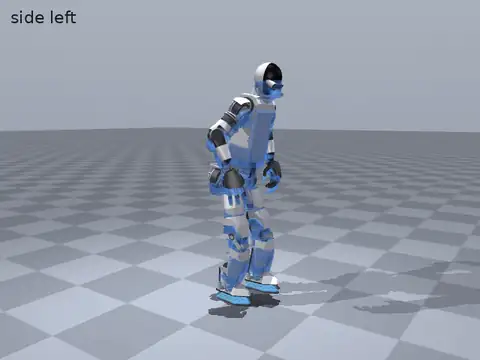 | 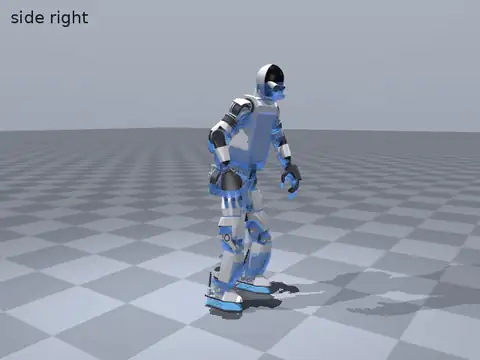 |
| joints 11.4°, hands 6.8 cm | joints 10.7°, hands 7.8 cm | joints 10.9°, hands 7.5 cm |

| Turn left | Turn right | Turn in place |
|---|---|---|
| 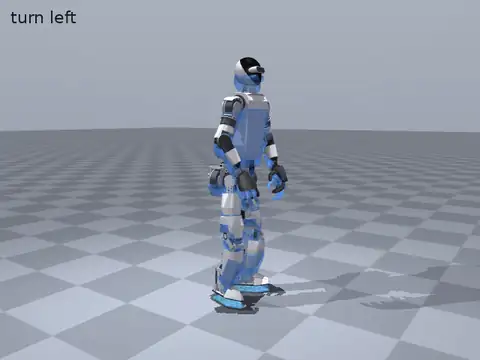 | 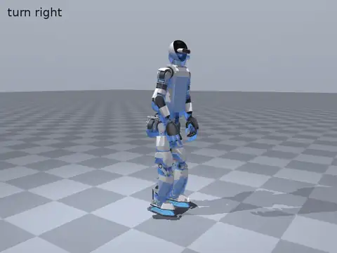 | 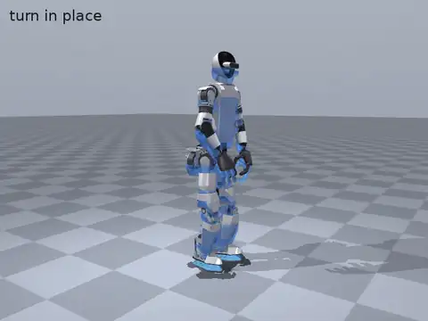 |
| joints 8.2°, hands 6.3 cm | joints 8.4°, hands 7.5 cm | joints 8.2°, hands 4.9 cm |

## Whole body

| Kick | Squat | Pick up |
|---|---|---|
|  |  | 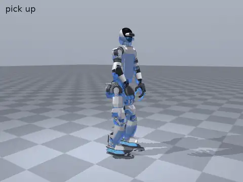 |
| joints 10.7°, hands 5.7 cm | joints 15.8°, hands 8.6 cm | joints 12.6°, hands 3.9 cm |

| Bow | Dance sway | Idle |
|---|---|---|
| 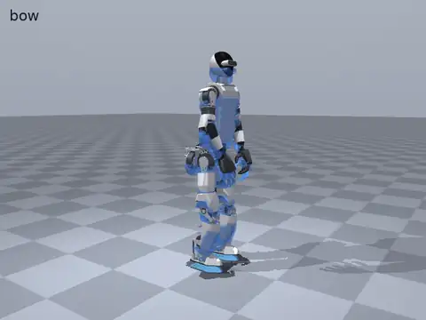 | 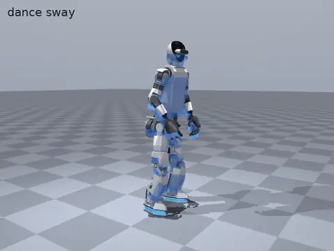 | 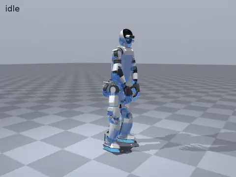 |
| joints 8.1°, hands 4.4 cm | joints 9.9°, hands 4.4 cm | joints 9.4°, hands 3.7 cm |

| Look around |
|---|
| 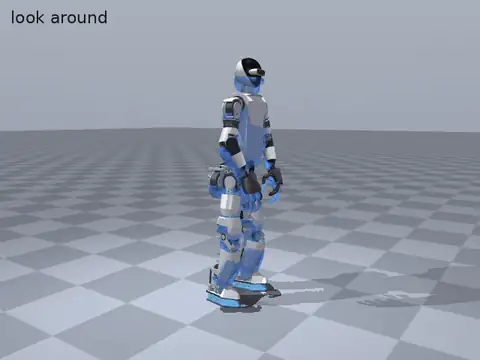 |
| joints 8.3°, hands 3.2 cm |

## Arms and gestures

| Clap | Wave | Wave both |
|---|---|---|
|  | 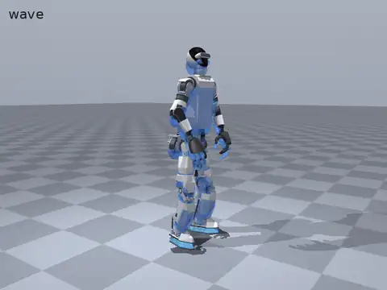 | 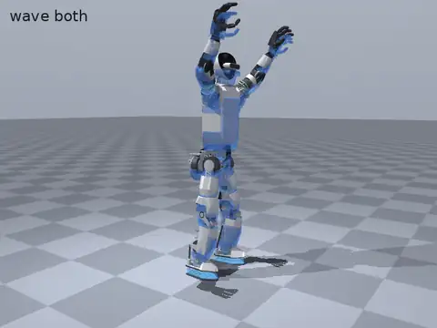 |
| joints 12.6°, hands 11.0 cm | joints 11.7°, hands 6.9 cm | joints 34.6°, hands 12.1 cm |

| Point | Reach forward | Arms raise |
|---|---|---|
| 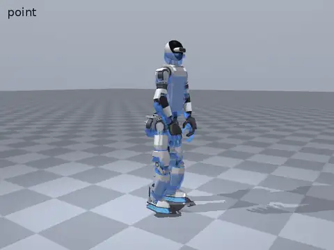 | 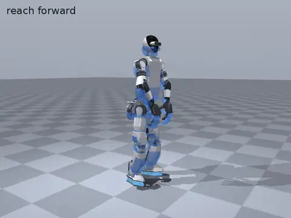 | 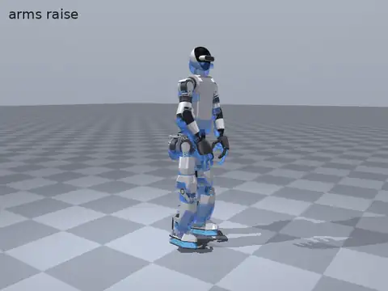 |
| joints 9.3°, hands 6.5 cm | joints 18.4°, hands 9.3 cm | joints 12.3°, hands 8.3 cm |
