# Skills in simulation

Every skill the motion tracker has learned, on the current 1.41 m model (RS10P arm motors, the
rounded head). The solid robot is the trained policy; the translucent blue robot is the reference
motion it follows (a human motion generated with Kimodo and retargeted to Marvin Bot). One policy
plays all 25 clips: tracker v6, warm-started from the previous tracker (about 5,000 epochs on the
1.44 m model) and trained 1,800 more epochs on the current model, on Newton with 16,384 robots at
once (about 3 hours on one GPU); every clip stays upright. Under each clip: the hands' and feet's
mean distance from where the reference puts them, measured relative to the pelvis.

The clips are rendered with `sim/motion/render_tracking.py`; how they are made, trained and scored
is in [sim/motion/README.md](../sim/motion/README.md). This is simulation only, though in two
simulators: replayed in MuJoCo (`sim/motion/replay_mujoco.py`) with sensor noise and the motors'
torque-speed limits, every clip stays upright and the hands, feet and joints track as closely as
in Newton, where it was trained. It has not run on hardware. The weakest skills are the
arm-heavy ones (the two-hand wave, reach forward, clap, arms raise: hands 9–13 cm off), and the
squat and pick-up stop 4.5 and 9 cm short of the reference's lowest point. The arm motors are
closest to their limits in the two-hand wave (the left shoulder yaw touches the RS10P's 42 N·m
peak) and the clap (the left shoulder roll at 78% of its rated torque, RMS).

## Walking and turning

| Walk | Walk slow | Walk back |
|---|---|---|
|  |  |  |
| hands 4.2 cm, feet 5.5 cm | hands 4.7 cm, feet 4.4 cm | hands 5.4 cm, feet 4.2 cm |

| Jog | March | Start stop |
|---|---|---|
|  |  |  |
| hands 4.1 cm, feet 6.1 cm | hands 4.9 cm, feet 6.1 cm | hands 3.6 cm, feet 4.8 cm |

| Carry walk | Side left | Side right |
|---|---|---|
|  |  |  |
| hands 6.7 cm, feet 5.5 cm | hands 6.2 cm, feet 5.3 cm | hands 7.2 cm, feet 5.2 cm |

| Turn left | Turn right | Turn in place |
|---|---|---|
|  |  |  |
| hands 4.7 cm, feet 4.6 cm | hands 5.2 cm, feet 5.5 cm | hands 2.6 cm, feet 6.4 cm |

## Whole body

| Kick | Squat | Pick up |
|---|---|---|
|  |  |  |
| hands 3.9 cm, feet 4.4 cm | hands 6.8 cm, feet 5.6 cm | hands 3.2 cm, feet 3.8 cm |

| Bow | Dance sway | Idle |
|---|---|---|
|  |  |  |
| hands 3.6 cm, feet 4.3 cm | hands 7.3 cm, feet 3.5 cm | hands 2.9 cm, feet 4.4 cm |

| Look around |
|---|
|  |
| hands 3.4 cm, feet 3.6 cm |

## Arms and gestures

| Clap | Wave | Wave both |
|---|---|---|
|  |  |  |
| hands 8.8 cm, feet 3.8 cm | hands 5.1 cm, feet 2.7 cm | hands 12.8 cm, feet 5.2 cm |

| Point | Reach forward | Arms raise |
|---|---|---|
|  |  |  |
| hands 3.4 cm, feet 2.9 cm | hands 9.7 cm, feet 4.8 cm | hands 8.8 cm, feet 1.8 cm |

## Lite

[Lite](design/lite.md) has no legs, so its clips keep only the upper body (waist, arms, wrists,
neck) from the same retargeted clips. Each clip's base path and column height are written as
keyframes, not taken from the hips, and kept inside the base controller's limits and the
column's 38 mm/s. Two upper bodies were generated for Lite: holding a box and handing something
over. `sim/motion/lite_clips.py` plays each clip on Lite's wheels in MuJoCo (rollers, torque
limits) with the joints' position servos. No learned policy is needed, since Lite does not
balance.

Under each clip:

- **hands:** how far the hands are from where the clip puts them;
- **wheels:** the two lightest wheels' lowest loads, as a share of a wheel's static share (both
  near 0% would mean tipping);
- **RMS:** the joint working hardest, as RMS torque against its rating.

Every clip stays on all four wheels, and no joint passes 33% of its rating.

| Idle | Look around | Point |
|---|---|---|
|  | 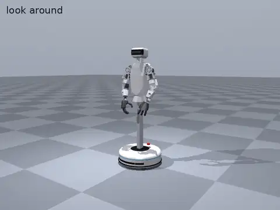 | 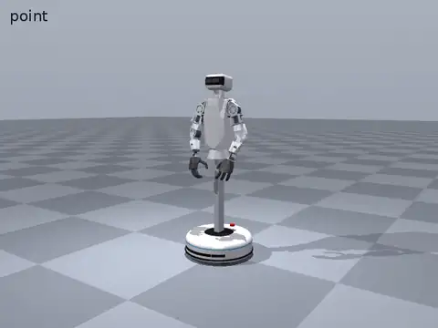 |
| hands 0.9 cm, wheels 95/97%, RMS 8% | hands 0.6 cm, wheels 92/94%, RMS 9% | hands 1.2 cm, wheels 83/88%, RMS 17% |

| Wave | Wave both | Clap |
|---|---|---|
|  | 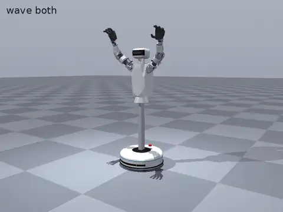 | 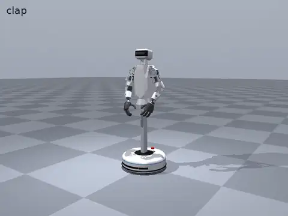 |
| hands 1.4 cm, wheels 77/85%, RMS 17% | hands 2.5 cm, wheels 70/75%, RMS 20% | hands 1.7 cm, wheels 63/74%, RMS 24% |

| Arms raise | Dance sway | Hand over |
|---|---|---|
| 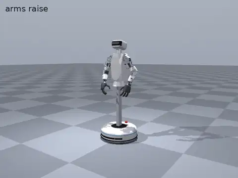 | 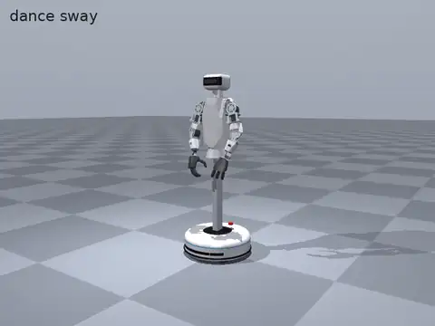 | 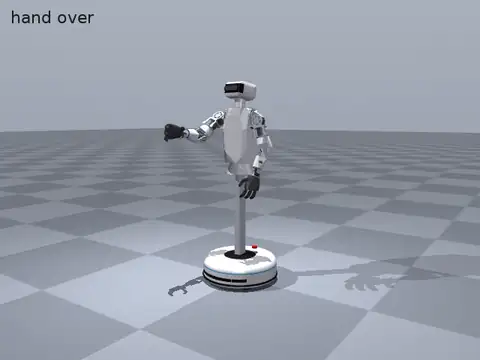 |
| hands 4.5 cm, wheels 93/95%, RMS 33% | hands 1.6 cm, wheels 16/45%, RMS 18% | hands 1.0 cm, wheels 90/92%, RMS 16% |

| Reach forward (column rises 0.10 m) | Carry (1 kg box, 1.2 m) | Turn (180°) |
|---|---|---|
| 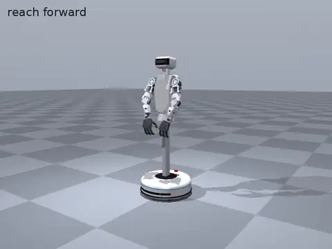 | 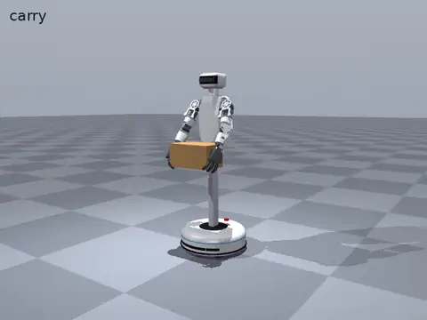 | 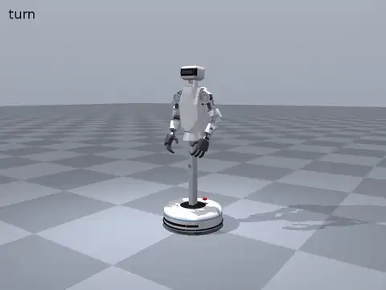 |
| hands 1.0 cm, wheels 52/63%, RMS 21% | hands 1.8 cm, wheels 73/74%, RMS 27% | hands 0.9 cm, wheels 92/92%, RMS 8% |

| Sidestep (0.6 m and back) | Wave while driving | Column rise |
|---|---|---|
| 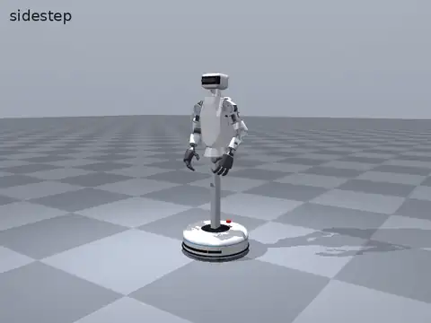 | 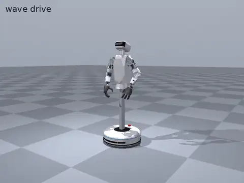 | 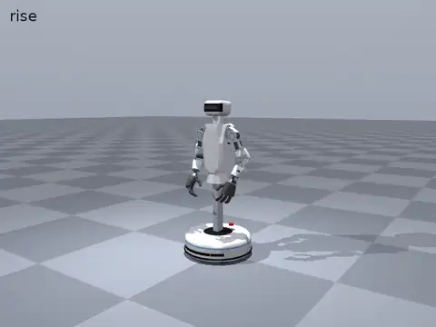 |
| hands 1.0 cm, wheels 81/84%, RMS 8% | hands 1.5 cm, wheels 70/84%, RMS 17% | hands 1.0 cm, wheels 96/98%, RMS 8% |

The dance sway is the closest to the base's limit: one wheel drops to 16% of its share as the
torso swings.

The leg clips (walking, jogging, sidesteps, the kick, the march) and the bow have nothing to map
onto. The squat and pick-up need a reach to the floor, which Lite's hands, at least 0.44 m up,
cannot make.
