# Skills in simulation

Every skill the motion tracker has learned, on the current 1.41 m model (RS10P arm motors, the
rounded head). The solid robot is the trained policy; the translucent blue robot is the reference
motion it follows (a human motion generated with Kimodo and retargeted to Marvin Bot). One policy
plays all 25 clips: tracker v6, warm-started from the previous tracker (about 5,000 epochs on the
1.44 m model) and trained 1,800 more epochs on the current model, on Newton with 16,384 robots at
once (about 3 hours on one GPU); every clip stays upright. Under each clip: the hands' and feet's
mean distance from where the reference puts them, measured relative to the pelvis.

The clips are rendered with `sim/motion/render_tracking.py`; how they are made, trained and scored
is in [sim/motion/README.md](../sim/motion/README.md). This is simulation only, though in two
simulators: replayed in MuJoCo (`sim/motion/replay_mujoco.py`) with sensor noise and the motors'
torque-speed limits, every clip stays upright and the hands, feet and joints track as closely as
in Newton, where it was trained. It has not run on hardware. The weakest skills are the
arm-heavy ones (the two-hand wave, reach forward, clap, arms raise: hands 9–13 cm off), and the
squat and pick-up stop 4.5 and 9 cm short of the reference's lowest point. The arm motors are
closest to their limits in the two-hand wave (the left shoulder yaw touches the RS10P's 42 N·m
peak) and the clap (the left shoulder roll at 78% of its rated torque, RMS).

## Walking and turning

| Walk | Walk slow | Walk back |
|---|---|---|
|  | 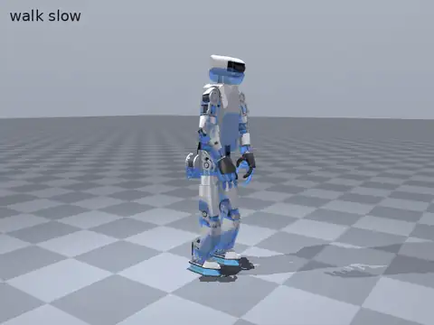 | 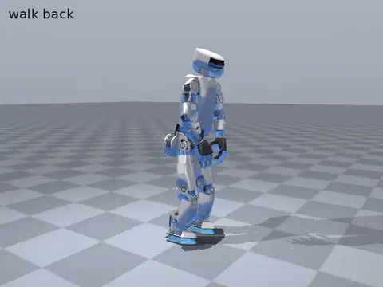 |
| hands 4.2 cm, feet 5.5 cm | hands 4.7 cm, feet 4.4 cm | hands 5.4 cm, feet 4.2 cm |

| Jog | March | Start stop |
|---|---|---|
| 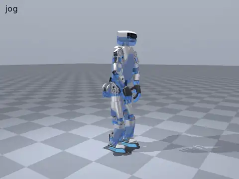 | 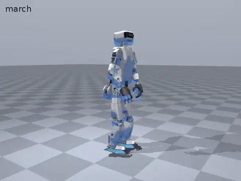 | 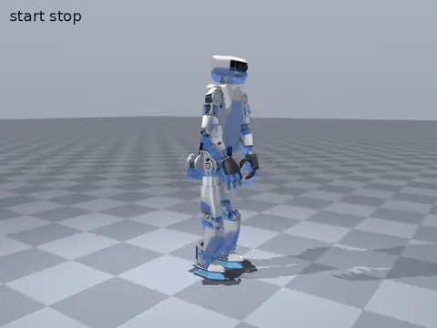 |
| hands 4.1 cm, feet 6.1 cm | hands 4.9 cm, feet 6.1 cm | hands 3.6 cm, feet 4.8 cm |

| Carry walk | Side left | Side right |
|---|---|---|
| 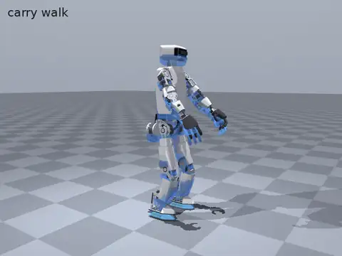 | 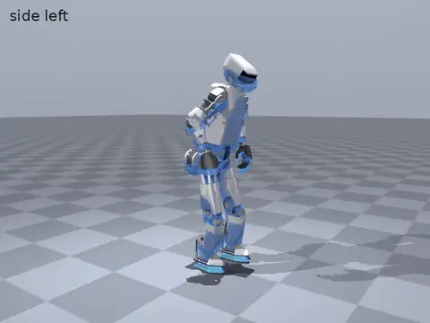 | 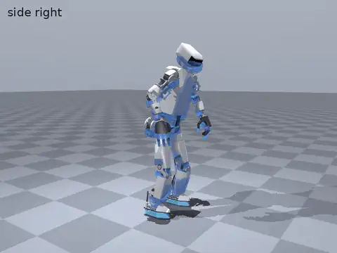 |
| hands 6.7 cm, feet 5.5 cm | hands 6.2 cm, feet 5.3 cm | hands 7.2 cm, feet 5.2 cm |

| Turn left | Turn right | Turn in place |
|---|---|---|
| 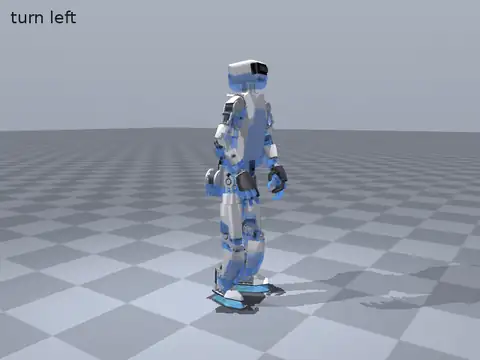 | 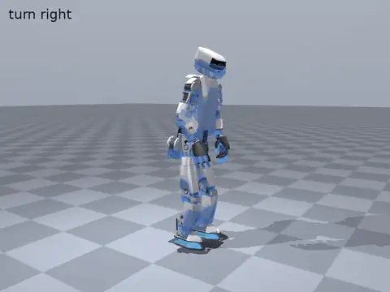 | 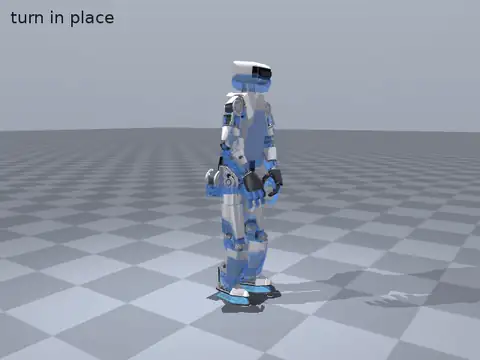 |
| hands 4.7 cm, feet 4.6 cm | hands 5.2 cm, feet 5.5 cm | hands 2.6 cm, feet 6.4 cm |

## Whole body

| Kick | Squat | Pick up |
|---|---|---|
| 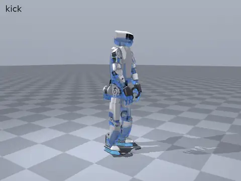 | 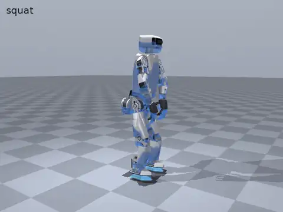 | 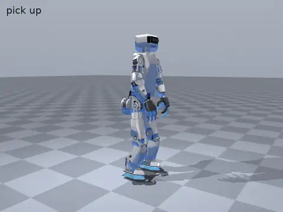 |
| hands 3.9 cm, feet 4.4 cm | hands 6.8 cm, feet 5.6 cm | hands 3.2 cm, feet 3.8 cm |

| Bow | Dance sway | Idle |
|---|---|---|
|  | 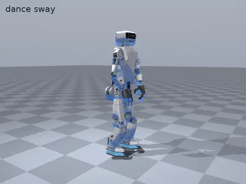 | 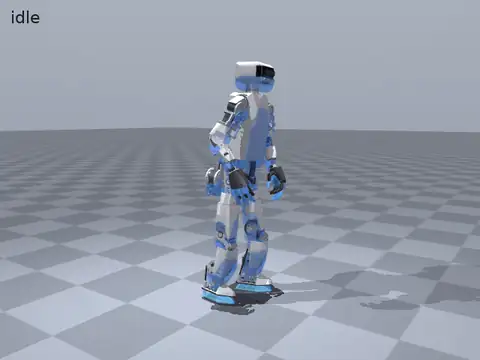 |
| hands 3.6 cm, feet 4.3 cm | hands 7.3 cm, feet 3.5 cm | hands 2.9 cm, feet 4.4 cm |

| Look around |
|---|
| 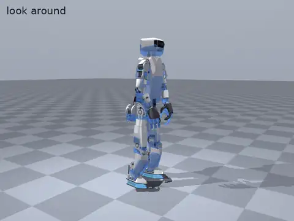 |
| hands 3.4 cm, feet 3.6 cm |

## Arms and gestures

| Clap | Wave | Wave both |
|---|---|---|
| 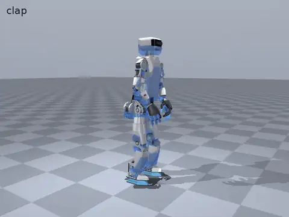 | 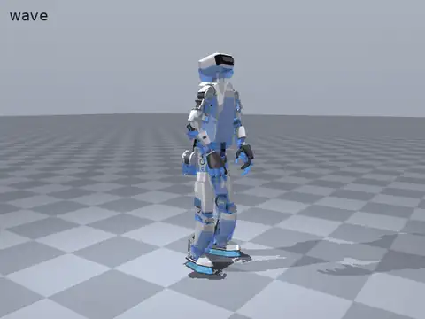 | 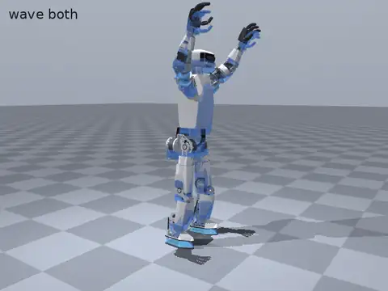 |
| hands 8.8 cm, feet 3.8 cm | hands 5.1 cm, feet 2.7 cm | hands 12.8 cm, feet 5.2 cm |

| Point | Reach forward | Arms raise |
|---|---|---|
| 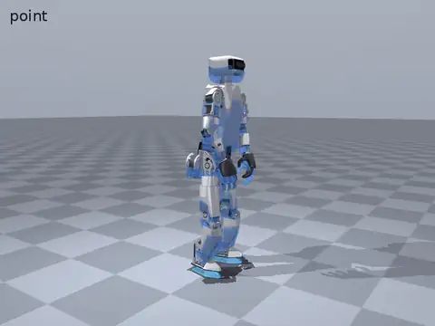 | 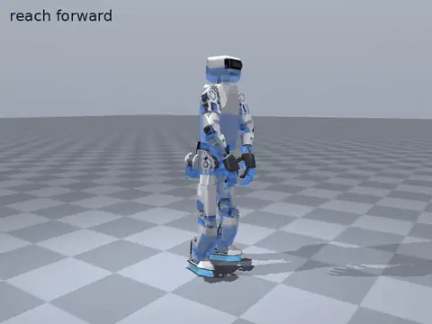 | 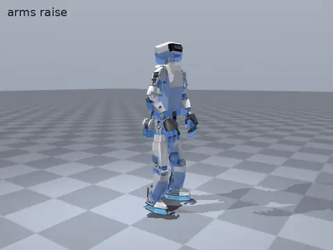 |
| hands 3.4 cm, feet 2.9 cm | hands 9.7 cm, feet 4.8 cm | hands 8.8 cm, feet 1.8 cm |
