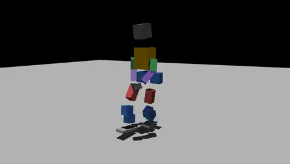

# Motion pipeline: human motion to a Marvin Bot tracking policy

Status: runs end to end; no tracking policy good enough to use yet. Eight walking, jogging and
turning clips retarget within every joint limit and train a tracker on Newton. The first tracker
counted every clip as tracked but shuffled on the spot (it covered 0-32% of the reference's
distance): the arms' collision boxes, which the retargeted arms pass through, held the legs, and
the scaled-down feet clipped each other. Both are fixed below and a second tracker is training.



Instead of writing rewards for each skill, train a policy that tracks a reference motion
(BeyondMimic-style motion tracking). A new skill is then a new clip, not new reward code. The
pipeline uses NVIDIA's open tools:

| Step | Tool | Here |
|---|---|---|
| Motions | [Kimodo](https://github.com/nv-tlabs/kimodo) (text to motion) or recorded human motion, on the SOMA skeleton | |
| Keypoints | ProtoMotions' `extract_retargeting_input_keypoints_from_packaged_motionlib.py` | |
| Retarget | ProtoMotions' PyRoki retargeter | `retarget_marvin_bot.py` |
| Convert, package | ProtoMotions' `convert_pyroki_retargeted_robot_motions_to_proto.py`, `motion_lib.py` | `fix_sole_height.py` |
| Track | [ProtoMotions](https://github.com/NVlabs/ProtoMotions) on Newton, BeyondMimic-style rewards | `setup_protomotions.py`, `check_tracking.py` |

`setup_protomotions.py` writes Marvin Bot's MJCF, retargeting URDF and robot config into a
ProtoMotions checkout, all generated from `description/`; rerun it after a description change.

What is specific to Marvin Bot:

- **Scale.** Human keypoints are scaled to Marvin Bot's size (legs about 0.66 of the source's,
  arms 0.62), then the knees and feet are moved 1.5 and 3 cm out along the hip axis: scaled
  down, the human's feet end up 12-14 cm apart and Marvin Bot's are 11 cm wide.
- **Arms collide with the ground only.** The retargeter's self-collision cost is off upstream,
  and the gripper boxes meet the thighs even with the arms hanging straight, so in the tracking
  model the arms do not collide with the body. A real robot would: the retargeted arms still
  need a collision fix before anything runs on hardware.
- **Soles.** ProtoMotions' converter puts the lowest body origin 4 cm above the floor, which
  suits G1's foot frame; `fix_sole_height.py` puts Marvin Bot's soles on the floor instead.
- **A second check.** ProtoMotions counts a clip as tracked when the torso height stays within
  25 cm of the reference's; `check_tracking.py` also compares the distance covered, the joint
  angles and the body positions, which is how the first tracker's shuffling showed up.

## Environments

ProtoMotions and PyRoki need separate Python environments (PyRoki uses JAX):

```bash
uv venv --python 3.12 venvs/proto
VIRTUAL_ENV=venvs/proto uv pip install torch --index-url https://download.pytorch.org/whl/cu128
VIRTUAL_ENV=venvs/proto uv pip install -r ProtoMotions/requirements_newton.txt
VIRTUAL_ENV=venvs/proto uv pip install -e ProtoMotions
git clone https://github.com/chungmin99/pyroki
uv venv --python 3.12 venvs/pyroki
VIRTUAL_ENV=venvs/pyroki uv pip install -e pyroki
```

ProtoMotions keeps its checkpoints, meshes and sample motions in Git LFS (about 6 GB).

## Steps

Run from the ProtoMotions checkout, with `$M` the marvin-bot checkout and `$W` a work folder.

```bash
venvs/proto/bin/python $M/sim/motion/setup_protomotions.py .
venvs/proto/bin/python data/scripts/extract_retargeting_input_keypoints_from_packaged_motionlib.py \
    <soma motions .pt> --output-path $W/keypoints --skeleton-format soma --start-idx 0 --skip-freq 1
venvs/pyroki/bin/python $M/sim/motion/retarget_marvin_bot.py --protomotions . \
    --keypoints-folder-path $W/keypoints --output-dir $W/retargeted --source-type soma --no-visualize
venvs/pyroki/bin/python $M/sim/motion/retarget_marvin_bot.py --protomotions . \
    --keypoints-folder-path $W/keypoints --output-dir $W/retargeted --source-type soma --no-visualize \
    --save-contacts-only --contacts-dir $W/contacts
venvs/proto/bin/python data/scripts/convert_pyroki_retargeted_robot_motions_to_proto.py \
    --retargeted-motion-dir $W/retargeted --output-dir $W/proto --robot-type marvin_bot \
    --contact-labels-dir $W/contacts --apply-motion-filter --force-remake
venvs/proto/bin/python $M/sim/motion/fix_sole_height.py . $W/proto
venvs/proto/bin/python protomotions/components/motion_lib.py --motion-path $W/proto \
    --output-file $W/marvin_bot_motions.pt
venvs/proto/bin/python protomotions/train_agent.py --robot-name marvin_bot --simulator newton \
    --experiment-path examples/experiments/mimic/mlp_bm_l2c2.py --experiment-name marvin_bot_track \
    --motion-file $W/marvin_bot_motions.pt --num-envs 4096 --batch-size 16384 --headless
venvs/proto/bin/python $M/sim/motion/check_tracking.py \
    results/marvin_bot_track/results/predicted_motion_lib_epoch_<N>.pt $W/marvin_bot_motions.pt
```

Retargeting takes about 10 minutes a clip (JAX recompiles for each clip length); the tracker
trains at about 2.5 s an epoch with 4096 robots on one RTX-class GPU.

## Data licences

Motion data is not committed. Check each source's terms before publishing anything trained on
it: the BONES-SEED motions (ProtoMotions' sample files and Kimodo's SEED models) are gated,
for academic use and qualifying startups; Kimodo's weights are under the NVIDIA Open Model
License, and its text encoder is Meta's gated Llama 3 8B Instruct; ProtoMotions' and PyRoki's
code is Apache-2.0 and MIT.
